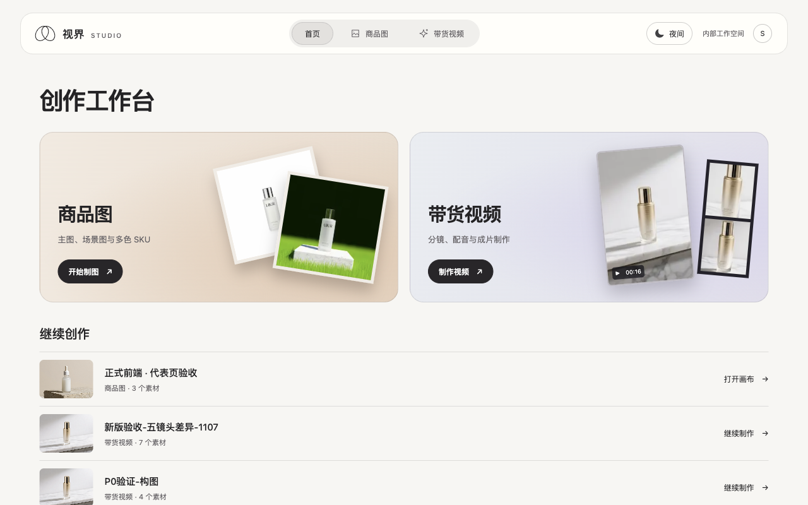
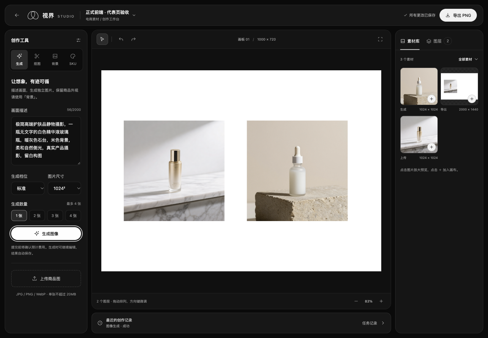
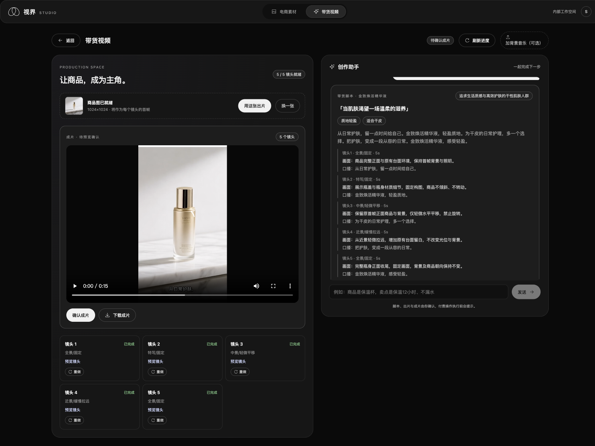

# 视界 Studio · AI Visual Studio

面向电商卖家的商品图与带货视频工作台。上传一张商品照，可以为它生成场景图、制作多色 SKU、在画布里排版导出，也可以从商品卖点开始，制作带旁白和中文字幕的竖屏短片。



## 商品图工作台

在项目中上传图片，使用抠图、换背景、生成或 SKU 变色工具。处理结果保存在素材库，可以加入画布、调整位置和尺寸、切换画板底色并导出 PNG。画布自动保存，导出前会等待最新布局保存成功。



## 带货视频工作台

1. 提供商品名称、卖点、风格和发布平台，审阅生成的口播和分镜。
2. 确认脚本并上传商品参考图，查看镜头数量与预计费用后提交生成。
3. 在工作台预览各个片段，必要时单独重做某一镜头。
4. 镜头齐备后自动配音、烧录中文分句字幕并合成竖屏 MP4。支持上传背景音乐，在项目内审阅和下载成片。



## 本地运行

推荐 macOS 或 Linux，Python 3.12、Node.js 20 LTS 或 22 LTS、npm 和 Git。后端的项目锁使用 POSIX 文件锁。Windows 用户可在 WSL2 中运行。

```bash
git clone https://github.com/Dublin-dd/ai-visual-studio.git
cd ai-visual-studio
cp backend/.env.example backend/.env
bash scripts/dev.sh
```

首次启动会创建 Python 虚拟环境、安装依赖并初始化 SQLite。打开[本地工作台](http://127.0.0.1:3010)，后端[健康检查](http://127.0.0.1:8010/api/health)位于 8010 端口。按 Ctrl+C 停止服务。新副本从空项目库启动。

### 模型与费用

在本机的 `backend/.env` 中配置密钥，修改后重启服务。

| 配置 | 用途 |
| --- | --- |
| `IMAGE_API_KEY` | SiliconFlow 密钥，用于商品图生成和编辑、带货脚本及视频生成 |
| `IMAGE_MODEL`、`IMAGE_MODEL_HQ` | 标准档和精修档图像模型 |
| `TTS_PROVIDER` | 配音供应商，可选 `siliconflow` 或 `minimax` |
| `MINIMAX_API_KEY`、`MINIMAX_VOICE_ID` | 使用 MiniMax 配音时设置 |
| `SUBTITLE_FONT`、`SUBTITLE_FONTS_DIR` | 中文字体名称与本机可读取的字体目录，Linux 环境请安装中文字库 |

浏览界面、上传素材、排版和画布导出均可本地完成。脚本、图像、视频、配音及镜头重做会调用对应供应商，报价为项目配置的估算值，实际费用以供应商账单为准。

## 实现与使用边界

- 前端使用 Next.js、React 和 TypeScript，支持日夜主题与窄屏布局。
- 后端使用 FastAPI、SQLAlchemy 和 SQLite。Pillow 负责图片合成，FFmpeg 负责音轨、字幕和视频合成。
- 默认数据位于 `backend/data/`。备份项目时请保存整个目录，包括数据库、上传文件和生成结果。
- 当前版本用于本地或受控内部试用，默认使用本地用户身份。公开部署前需要补齐身份认证与后端数据隔离。
- 单图生成视频时，模型可能重绘包装小字，或未严格遵循固定机位、平移等分镜要求。字幕按短语估算显示时间，成片应人工审阅。

## 开发与验证

```bash
# 后端测试（从仓库根目录执行）
backend/.venv/bin/python -m pytest -q backend/tests

# 前端测试与生产构建
cd frontend
npm test -- --run
npm run lint
npm run build
```

`scripts/` 包含开发启动与重启恢复检查脚本，`verify.sh` 可运行项目自检。MIT 授权及原版权声明见 [LICENSE](LICENSE)。
